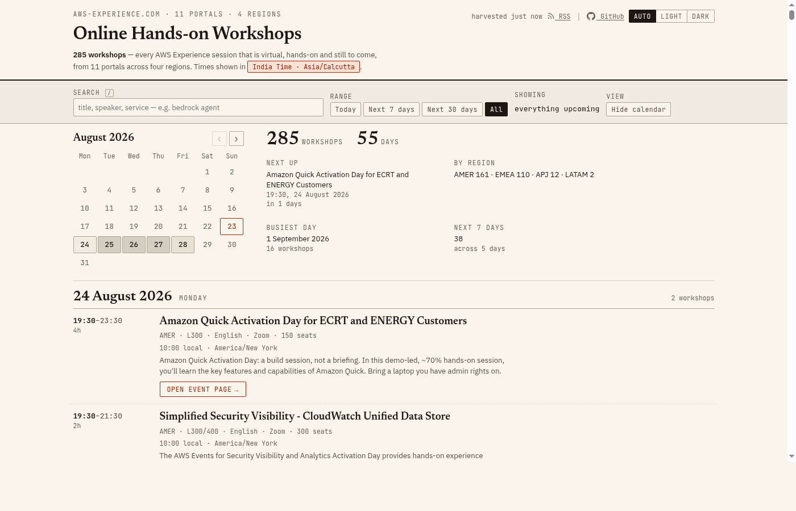

# aws-workshops

Every **online, hands-on AWS workshop** that is still open to register for, on one
page, in your own timezone.

**→ [paresh-maheshwari.github.io/aws-workshops](https://paresh-maheshwari.github.io/aws-workshops/)**



## Why this exists

AWS runs free hands-on workshops through [aws-experience.com](https://aws-experience.com),
but they are scattered across **eleven regional portals** (AMER, EMEA, APJ, LATAM)
with no combined view. Each portal has its own page, so you have to click through
each region manually.

This tool harvests all eleven portals every six hours and renders a single
searchable page with all upcoming virtual hands-on workshops in one place.

## Features

- **Unified view** — all 11 portals, 4 regions, one page
- **Your timezone** — times shown in your local timezone automatically
- **Search & filter** — by title, speaker, service, date range
- **Calendar view** — visual mini-calendar with workshop counts
- **Dark mode** — auto/light/dark theme support
- **RSS feed** — subscribe for new workshop notifications
- **Zero dependencies** — single Go binary, no database, no config files

## Run it locally

```bash
go build -trimpath -ldflags="-s -w" -o awsworkshops main.go
./awsworkshops                  # http://127.0.0.1:8765
./awsworkshops -open            # ...and open a browser
```

First start takes about ten seconds (22 requests, paced to avoid throttling).

## Flags

| Flag | Default | Meaning |
|---|---|---|
| `-addr` | `127.0.0.1` | interface to bind |
| `-port` | `8765` | port |
| `-refresh` | `6h` | background re-harvest interval; `0` disables |
| `-open` | `false` | open the page once ready |
| `-dump FILE` | — | write harvested JSON and exit |
| `-static FILE` | — | write rendered HTML page and exit |
| `-rss FILE` | — | write RSS feed (use with `-static`) |
| `-version` | — | print version |

## Routes

| Route | Purpose |
|---|---|
| `/` | the page |
| `/api/workshops` | JSON data |
| `/refresh` | re-harvest now |
| `/healthz` | status and warnings |

## RSS feed

**→ [paresh-maheshwari.github.io/aws-workshops/feed.xml](https://paresh-maheshwari.github.io/aws-workshops/feed.xml)**

The feed includes the 50 soonest workshops, refreshed every six hours. The HTML
page has RSS autodiscovery, so feed readers will find it automatically.

```bash
./awsworkshops -static index.html -rss feed.xml
```

## Deployment

The GitHub Actions workflow (`.github/workflows/deploy.yml`) harvests and
publishes to GitHub Pages every six hours. Enable with **Settings → Pages →
Source: GitHub Actions**.

No secrets needed — the AWS Experience API is public.

## What gets listed

An event appears only if it is **all four** of:

- `virtual` — not in-person
- `handsonworkshop` — not a webinar or briefing
- `status=live` — not draft or cancelled
- starts in the future — not already begun

## Technical notes

<details>
<summary>Click to expand</summary>

### De-duplication

Keyed on `id` only. Do not merge on title — 56 titles run on multiple portals,
and 7 title+start pairs have different ids (separate sessions with different
speakers).

### Timezones

UTC instants are converted in-browser using `Intl.DateTimeFormat`. DST is
handled correctly. `Asia/Kolkata` is the fallback.

### Throttling

Concurrency 3, 200ms pacing, 3 retries with backoff. Failed endpoints are
logged in `/healthz`.

### Event links

Uses `/e/<slug>` format. About 13 records have no slug and fall back to the
portal calendar.

</details>

## Star this repo ⭐

If you find this useful, please star the repo!

**→ [github.com/Paresh-Maheshwari/aws-workshops](https://github.com/Paresh-Maheshwari/aws-workshops)**

## Licence

Event data belongs to Amazon Web Services and comes from aws-experience.com.
This is an unofficial view and is not affiliated with AWS.
